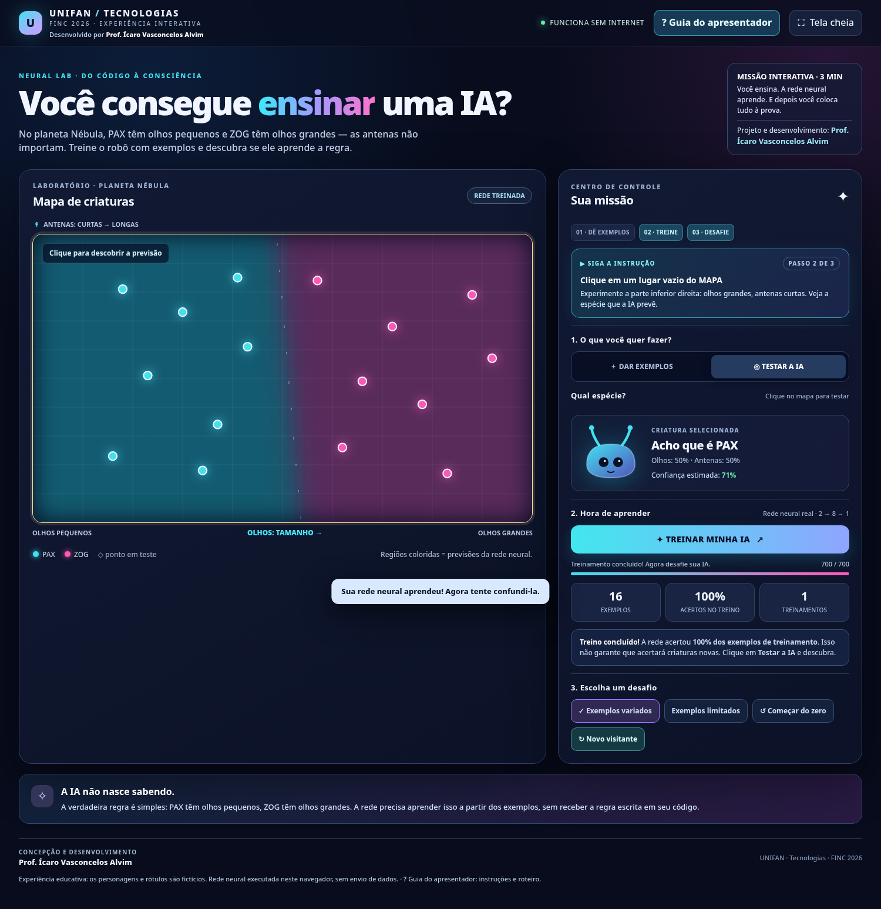

<div align="center">

# 🧠 NEURAL LAB
### Você consegue ensinar uma Inteligência Artificial?

**Uma experiência interativa de aprendizado de máquina — do código à consciência.**

**UNIFAN · Tecnologias · FINC 2026**  
*Inteligência Artificial: a era da inteligência humana*

**Concepção e desenvolvimento: Prof. Ícaro Vasconcelos Alvim**

`100% no navegador` · `Funciona offline` · `Sem instalação` · `Rede neural real` · `Experiência de ~3 minutos`

</div>



---

## ✨ Sobre o projeto

O **Neural Lab** é uma experiência educativa e interativa desenvolvida para a **FINC 2026**, no âmbito do **UNIFAN Tecnologias**, com o propósito de aproximar o público dos conceitos fundamentais da Inteligência Artificial (IA) de forma acessível, prática e envolvente.

A proposta é simples: em vez de apenas assistir a uma apresentação sobre IA, **o visitante assume o papel de quem ensina uma máquina**. Ele fornece exemplos, acompanha o aprendizado de uma rede neural, testa suas previsões e descobre por que uma IA pode cometer erros — mesmo quando parece ter aprendido tudo.

O experimento acontece no fictício **planeta Nébula**, onde vivem duas espécies:

- 🔵 **PAX:** criaturas de **olhos pequenos**.
- 🩷 **ZOG:** criaturas de **olhos grandes**.

O tamanho das antenas **não determina** a espécie. O desafio é fazer uma rede neural descobrir essa relação observando exemplos, sem receber diretamente a regra de classificação.

> **Ideia central:** a inteligência artificial aprende padrões a partir de dados. Mas aprender os exemplos de treinamento não significa, necessariamente, compreender a regra correta ou acertar situações novas.

## 🎯 Objetivos educacionais

Ao final da experiência, espera-se que o participante consiga:

- Entender, de maneira intuitiva, como exemplos são usados para **treinar um modelo de IA**.
- Diferenciar **dados de treinamento** de **novos dados usados para teste**.
- Perceber como a **diversidade e a qualidade dos dados** influenciam os resultados.
- Identificar situações em que um modelo aprende **associações inadequadas**.
- Reconhecer a importância das **decisões e da supervisão humanas** no desenvolvimento de soluções com IA.

**Público-alvo:** estudantes do Ensino Médio, universitários e visitantes em geral. **Não é necessário saber programar.**

---

## 🚀 Como executar

**Requisitos:** um notebook ou computador com **Google Chrome** ou **Microsoft Edge**. Projetor é opcional.

1. Extraia o conteúdo do arquivo `.zip`, se estiver usando o pacote completo.
2. Localize o arquivo **`laboratorio_ia_unifan.html`**.
3. Abra-o com dois cliques no Chrome ou Edge.
4. Clique em **`? Guia do apresentador`** para visualizar as orientações dentro da própria aplicação.
5. Para uma apresentação projetada, use **`Tela cheia`** ou pressione **`F11`**.

**Pronto!** Não é necessário instalar programas, configurar servidor, criar contas ou acessar a internet. Os estilos, a lógica do jogo e o código da rede neural estão no próprio arquivo HTML.

> 💡 **Dica para o evento:** abra o HTML com antecedência, coloque-o em tela cheia e deixe selecionado **“Exemplos variados”**. Assim, o próximo visitante pode começar clicando diretamente em **“TREINAR MINHA IA”**.

---

## 🎮 Como funciona a experiência

### 1. Ensine a IA

O mapa apresenta exemplos das espécies PAX e ZOG. Cada ponto corresponde a uma criatura, descrita por **duas características**: tamanho dos olhos (eixo horizontal) e tamanho das antenas (eixo vertical).

A aplicação já inicia com exemplos para facilitar a primeira demonstração. O participante também pode selecionar **`DAR EXEMPLOS`**, escolher PAX ou ZOG e clicar no mapa para adicionar novas criaturas.

### 2. Treine a rede neural

Clique em **`TREINAR MINHA IA`**. Uma rede neural de verdade, implementada em JavaScript, ajustará seus parâmetros com base nos exemplos disponíveis.

Durante o treinamento, uma barra mostra o andamento. Depois, o fundo do mapa passa a mostrar as **regiões de previsão** do modelo: onde ele tenderia a responder PAX ou ZOG.

### 3. Coloque a IA à prova

Após o treinamento, o modo **`TESTAR A IA`** é ativado. Clique em uma região do mapa para criar uma criatura ainda não apresentada ao modelo e confira sua previsão.

Compare a resposta da rede com a regra verdadeira do planeta: **olhos pequenos = PAX; olhos grandes = ZOG**. As antenas não deveriam alterar a classificação.

### 4. Corrija e ensine novamente

Depois de testar, a interface permite adicionar a **classificação correta** daquela criatura aos exemplos de aprendizagem, usando o botão **`✓ Ensinar PAX/ZOG`** correspondente.

Clique novamente em **`TREINAR MINHA IA`** para verificar como a inclusão desse exemplo pode alterar as previsões.

### 5. Prepare para a próxima pessoa

Use **`↻ Novo visitante`** para reiniciar a atividade e restaurar os exemplos iniciais. Basta um clique para começar outra apresentação.

---

## 🎤 Roteiro rápido para o monitor — cerca de 3 minutos

| Etapa | Tempo sugerido | Ação / fala sugerida |
|:--|:--|:--|
| **Apresente o desafio** | 20 s | “Estas criaturas pertencem a dois grupos. A IA ainda precisa aprender a diferenciá-las.” |
| **Mostre os exemplos** | 20 s | “PAX tem olhos pequenos; ZOG tem olhos grandes. As antenas não definem a espécie.” |
| **Treine** | 30 s | Clique em **TREINAR MINHA IA** e mostre como o mapa muda de cor. |
| **Desafie o visitante** | 40 s | Peça que clique em uma região sem exemplos e tente encontrar um erro. |
| **Corrija** | 30 s | Use **✓ Ensinar** com a espécie correta e treine novamente. |
| **Conclua** | 20 s | “Uma IA pode acertar no treino e errar fora dele. Os dados e os testes importam!” |
| **Reinicie** | 5 s | Clique em **↻ Novo visitante**. |

> **Para quem nunca apresentou o projeto:** não é preciso explicar matemática ou programação. Leia o painel **“▶ SIGA A INSTRUÇÃO”** na tela: ele indica o próximo passo e destaca onde clicar. O botão **`? Guia do apresentador`** traz um roteiro mais detalhado dentro da aplicação. Há também uma versão em texto em [`GUIA_DO_APRESENTADOR.txt`](GUIA_DO_APRESENTADOR.txt).

### Perguntas que ajudam a envolver o público

- **“Você acha que a IA acertará uma criatura que nunca viu?”**
- **“E se todos os exemplos de uma espécie tiverem antenas parecidas?”**
- **“Acertar 100% dos exemplos usados no treino significa que ela nunca vai errar?”**

---

## 🧪 Experimentos disponíveis

| Experimento | O que fazer | Conceito trabalhado |
|:--|:--|:--|
| **Exemplos variados** | Carregue os exemplos iniciais e treine a IA. | Aprendizado supervisionado e generalização. |
| **Exemplos limitados** | Treine e teste criaturas em regiões pouco representadas nos dados, especialmente olhos grandes com antenas curtas (parte inferior direita). | Viés amostral e associações inadequadas. |
| **Começar do zero** | Crie seus próprios exemplos de PAX e ZOG antes de treinar. | Importância dos dados de treinamento. |
| **Ensinar após um teste** | Adicione uma classificação correta, treine novamente e compare. | Correção e refinamento do modelo. |

**Observação:** a IA aprende numericamente; não há uma sequência de respostas predefinidas para cada clique. Portanto, os erros e os percentuais exibidos **podem variar conforme os exemplos e o treinamento**. O modo de exemplos limitados favorece a observação de dificuldades de generalização, mas não garante o mesmo erro em toda execução.

---

## ⚙️ Como a IA funciona por trás da interface?

O Neural Lab utiliza uma **rede neural artificial do tipo feedforward**, com arquitetura **2 → 8 → 1**:

- **2 entradas:** tamanho dos olhos e tamanho das antenas.
- **8 neurônios na camada oculta:** combinam as informações recebidas.
- **1 saída:** estimativa usada para classificar uma criatura como PAX ou ZOG.

O treinamento ocorre no navegador, por **retropropagação do erro e atualização dos pesos**, com **700 épocas por treinamento**. As regiões coloridas do mapa representam as decisões produzidas pela rede a partir de suas previsões.

A classificação correta é conhecida pelo *experimento*, mas **não é fornecida diretamente à rede como uma regra programada**: o modelo precisa ajustar seus pesos a partir dos exemplos rotulados.

**Tecnologias:** HTML5, CSS3 e JavaScript puro, incluindo renderização em `canvas`. **Sem bibliotecas externas, API de IA ou conexão com serviços de terceiros.**

<details>
<summary><strong>Por que a taxa de acertos no treino pode enganar?</strong></summary>

Uma rede neural pode aprender a reproduzir muito bem os exemplos conhecidos sem ter desenvolvido uma regra que funcione para todos os novos casos. No experimento, isso fica especialmente evidente quando a amostra é concentrada em certas regiões do mapa. O problema ilustra a diferença entre **desempenho de treinamento** e **capacidade de generalização**.

</details>

---

## 🧰 Orientações para o dia da FINC

**Checklist antes de receber visitantes**

- [ ] O arquivo `laboratorio_ia_unifan.html` abre corretamente no notebook.
- [ ] O projeto está visível em tela cheia, se houver projetor.
- [ ] O cenário **Exemplos variados** está carregado.
- [ ] O botão **TREINAR MINHA IA** funciona.
- [ ] O monitor sabe abrir **Guia do apresentador**.
- [ ] O monitor sabe usar **Novo visitante** para reiniciar.

**Soluções rápidas**

| Situação | O que fazer |
|:--|:--|
| A rede não aceita iniciar o treino | Inclua pelo menos **2 exemplos de cada espécie** ou clique em **Novo visitante**. |
| Alguém adicionou pontos inesperados | Clique em **Novo visitante** para restaurar o cenário inicial. |
| Quer mostrar uma falha de aprendizado | Selecione **Exemplos limitados**, treine e teste na parte inferior direita do mapa. |
| O mapa não mostra as previsões atualizadas | Clique novamente em **TREINAR MINHA IA** após alterar os exemplos. |
| O monitor esqueceu os passos | Abra **Guia do apresentador** ou acompanhe **SIGA A INSTRUÇÃO**. |

**Privacidade:** a demonstração não solicita identificação nem usa câmera ou microfone. As interações e o treinamento acontecem localmente no navegador; não há envio de dados dos visitantes para um servidor.

---

## 📁 Estrutura dos arquivos

```text
Neural-Lab-UNIFAN/
├── laboratorio_ia_unifan.html     # Aplicação interativa; único arquivo necessário para executar
├── README.md                      # Apresentação e documentação do projeto
├── GUIA_DO_APRESENTADOR.txt       # Roteiro rápido para os monitores
├── LEIA_PRIMEIRO.txt              # Instruções de abertura em poucos passos
├── previa_aplicacao_atualizada.png
└── previa_guia_monitor.png
```

Os arquivos de imagem são **pré-visualizações** para documentação e divulgação. **O HTML funciona independentemente deles.**

---

## 👨‍🏫 Autoria e contexto institucional

**Prof. Ícaro Vasconcelos Alvim**  
**Concepção e desenvolvimento do projeto Neural Lab**  
**UNIFAN · Área de Tecnologias**

Experiência educativa concebida para a **FINC 2026**, em diálogo com os temas institucionais **“Do Código à Consciência: o Poder da Inteligência Artificial”** e **“Criando inteligências: Do código à Inteligência Artificial”**.

O projeto procura evidenciar que construir sistemas inteligentes envolve não apenas algoritmos, mas também **criatividade, pensamento crítico, escolhas humanas e responsabilidade sobre os resultados**.

*Para reutilização institucional ou adaptações do material, preserve o crédito de concepção e desenvolvimento indicado acima. Não foi definida uma licença de software aberta para este pacote.*

---

<div align="center">

### **A IA aprende com exemplos. A inteligência humana decide o que ensinar.**

**NEURAL LAB · FINC 2026 · UNIFAN TECNOLOGIAS**  
*Projeto e desenvolvimento: Prof. Ícaro Vasconcelos Alvim*

</div>
